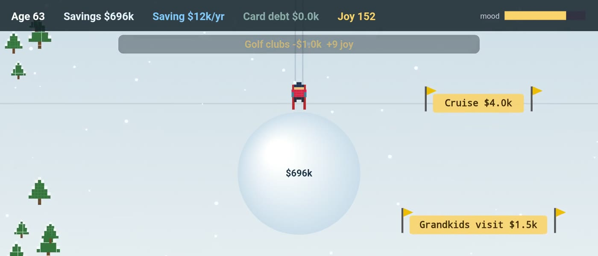
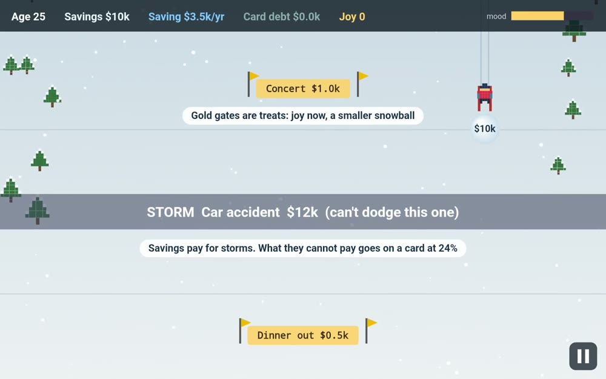
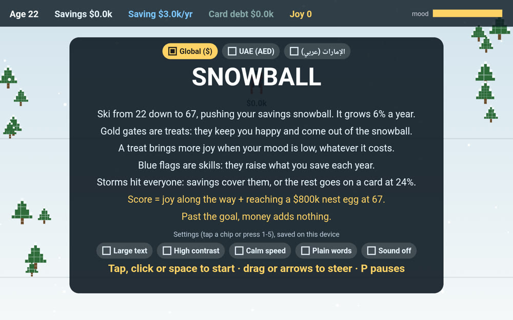
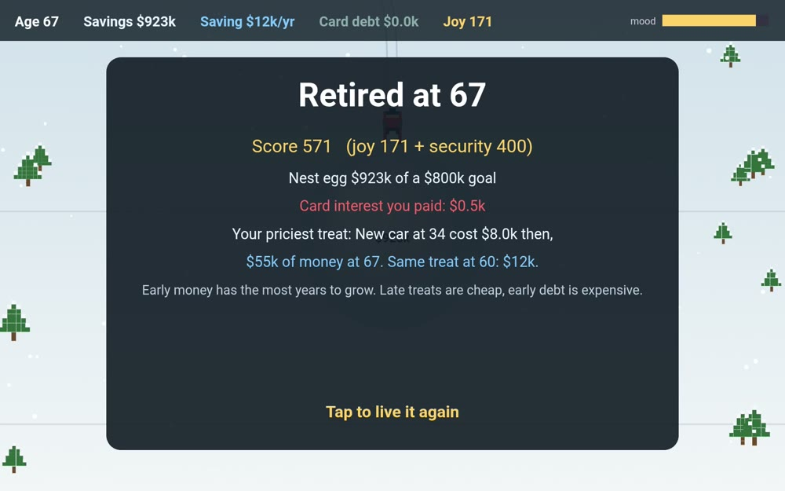
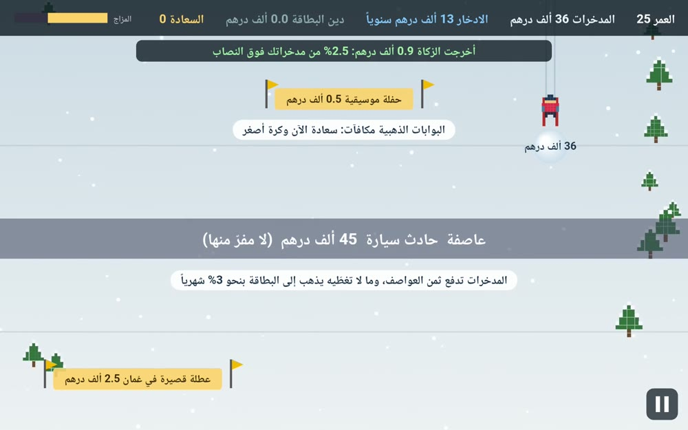

# Snowball

**Game Concept Document** for Zoud GameLab 2026, theme: Make FinLit Fun. Describes the submitted build.

[Play in the browser](https://designmaster-solutions.github.io/snowball-zoud/) · [Arabic edition](https://designmaster-solutions.github.io/snowball-zoud/?edition=uae-ar) · [2-minute gameplay video](https://youtu.be/YU_MAHViJfc) · [Game budget (separate document)](https://designmaster-solutions.github.io/snowball-zoud/docs/BUDGET.pdf) · [Source code](https://github.com/DesignMaster-Solutions/snowball-zoud)

## 1. Game Overview

Snowball is a skiing game about a whole working life. You ski from age 22 to 67 pushing your savings ahead of you as a snowball. Left alone it grows on its own, treats take a bite out of it, and storms you cannot dodge show why an emergency fund matters.

| | |
|-----------------|-----------------------------------------------------------------|
| **Title and genre** | Snowball (كرة الثلج). Arcade skiing with light money management |
| **Platform** | Any browser today, by touch, mouse or keyboard. On a phone, play in landscape. iOS and Android come with funding |
| **Audience** | Young adults aged 16 to 30 getting their first salary, and the teachers and programs that want to talk about money with them without a lecture |
| **Length** | One life takes about 80 seconds (under 2 minutes at Calm speed), so it fits a class, a commute or a waiting room |
| **Editions** | Global ($), UAE (AED) in English, and UAE in Arabic, right to left |

**What makes it different.** The money is a physical thing. The ball is your balance: you watch it grow slowly at 22 and quickly at 60, and you steer it yourself. Because the ball is what touches things, the bigger it gets, the less room it leaves around each gold gate. There is no quiz, no menu of choices and no game over. Everyone reaches 67, and then the game prices what your choices cost.

## 2. Core Gameplay

**Objective.** Reach 67 with the best life score: joy along the way plus security at the end.

**Actions.** Steer left and right, by dragging or with the arrow keys. That is the only input, so anyone can play from the first second.

**The loop.** Every row of the slope is a small decision, and about every 1.5 seconds a year of life goes by.

1. **Gold gates are treats.** Ski through for joy, and the price comes out of the ball. Ski around and you keep the money, but your mood keeps falling.
2. **Blue flags are skills.** Each one raises what you save every year. From age 25 a rarer flag offers an employer match, which is worth three skills.
3. **Storms cross the whole slope** and cannot be dodged. Savings pay for them. What savings cannot cover goes on a credit card.
4. **Every year** savings grow, debt grows, your yearly saving pays the card first, and mood falls.
5. **At 67** you get a score and a receipt: "Your priciest treat: Beach vacation at 37 cost $4.0k then, $23k of money at 67. Same treat at 60: $6.0k."

**Decisions and progress.** Which treat, and when? Is that flag worth steering past that gate? Four life stages change what tempts you and what hits you: First job (22), Family years (32), Peak earning (47) and Almost there (58). A concert becomes a new car, then a kitchen remodel, then a visit to the grandkids.

**Why it is fun to repeat.** It is a downhill run with a ball that visibly swells. Rows and storms are random, so no two lives match. A life is short, the receipt names something you chose, and "Tap to live it again" is one touch away.

| | |
|-------------------------------------|-----------------------|
|  | **The tutorial is played.** After one short rules card, the first three rows are one skill, one treat and one storm, each with one line of text, while the slope slows to 40%. |

## 3. Financial Literacy Integration

There is no lesson screen during play: one short rules card before you start and one closing line at 67. Every other idea is a rule of the slope, so the player meets it by playing.

| **Concept** | **The mechanic** | **What the player lives through** |
|---------------|-----------------------------|------------------------------------|
| Compound growth | The ball grows 6% a year by itself | Slow at first, then it swells: $38k at 33 and $646k at 62 in the run in our video |
| Opportunity cost | A treat leaves the ball, and the receipt prices it in money at 67 | A $4k trip at 37 turns out to have been $23k |
| Emergency fund | Storms cannot be dodged, and savings absorb them | The tutorial's $12k car accident at 25 is bigger than anyone's savings, so every player meets the card once; later storms only hurt a player who spent the reserve |
| High-interest debt | The overflow goes on a card at 24%. The card drags the ball, and yearly saving pays it first | If you overspend early, debt is felt in the hands: steering turns slow, and saving stops until the card is gone |
| Earning and saving more | Blue flags raise yearly saving, and an employer match is free money | A flag taken at 25 keeps paying for 42 years |
| Balance | Mood falls every year without a treat. At zero you burn out and splurge $3k with no joy | Saving everything is not the answer either |
| Spending with intent | A treat's joy depends on how worn down you are, not on its price: 2 points when you are fine, up to 30 when you are worn out | Sneakers when you are exhausted beat a car when you are fine |
| Lifestyle creep | Treats get pricier with age, and the growing ball leaves less room around each gate | Wanting more comes with earning more |
| Enough is a goal | Security counts up to an $800k nest egg (about $32k a year at the 4% rule) and nothing past it | "You could have enjoyed more" |

**The score punishes hoarding and overspending.** Six ways to live, measured with the game's own money model (saving $3k a year, no skills, no storms; pinned in `tests/econ.test.mjs`):

| **Way of living** | **Joy** | **Security** | **Score** |
|-----------------------------------|------:|------:|------:|
| Never treat yourself | 0 | 275 | 275 |
| A $1k treat every 5 years | 164 | 298 | **462** |
| A $1k treat every 2 years | 200 | 260 | 460 |
| A $1k treat every year | 222 | 205 | 427 |
| A $2k treat every year | 222 | 89 | 311 |
| A $4k treat every year, more than you save | 222 | -400 | -178 |

In the full game, blue flags raise saving to about $12k a year. In 100 simulated lives per strategy (robots, not people, global edition, build 0.6), taking the flags and only the gates under $2k scores about 590 and taking the flags and treating only when mood runs low about 565, while hoarding scores about 465, taking every flag and gate about 435, never steering about 425, and taking every gate while dodging the flags about 230. Every life meets the card once, in the tutorial, and the yearly saving clears it within about a year; the player who takes every gate and skips the flags carries it for about four.

### What we hope players understand after playing

1. Money invested early has the most years to grow. Saving $3k a year from 22 ends at $638k and from 32 at $334k: $30k less put in, $304k less at 67.
2. An emergency fund is what keeps a storm from becoming high-interest debt.
3. Card debt grows faster than savings, and it eats the money you meant to save.
4. Enjoying life is part of the plan. A cheap treat gives as much joy as an expensive one, a treat when you are worn down gives the most, and a late treat costs far less future money than an early one.

Each lesson maps to something a first salary can do: start saving now, keep a small emergency fund, clear the card before investing, and plan for small treats.

**Accuracy.** 6% is a long-run average for a diversified index fund, not a promise. 24% is a typical card APR. The model leaves out inflation and taxes so it stays readable, the ball never falls with the market, and the card has no limit. $800k is a game target on top of a pension, not a retirement recommendation, and the game is not financial advice. The core rules are one file with no graphics (`econ.js`), and prices and editions a second one (`region.js`), both with tests.

**UAE and Arabic edition, built during the jam.** Same game, different money. Treats and storms are priced in dirhams for Gulf life, not converted from dollars. Saving, skills and the goal convert at the 3.6725 peg. The snowball sits in a Sharia-compliant fund and earns profit, not interest. Zakat takes 2.5% of what you own once that reaches the nisab (fixed at AED 35k in the game, while the real figure moves with gold). It leaves the ball, but the score counts it at what it would have grown to, so the money you give still counts in your score, and players it does not apply to can turn it off. The UAE's end-of-service gratuity savings plan replaces the employer match. Cards cost about 3% a month. Treats and storms come from Gulf life: a weekend in Oman, Eid shopping and Eidiya, the rent deposit and agent fee, school fees rising, an AC breakdown in August.

## 4. Visual Style & Player Experience

| | | |
|-----------------------|-----------------------|-----------------------|
|  |  |  |
| Title card: editions and settings | At 67: the score and the receipt | UAE edition in Arabic, right to left |

**Art direction.** A top-down winter slope, seen from above: a pixel-art skier and pines, gold slalom gates, blue flags, falling snow and a ski trail behind you. Everything is drawn in code, with no image files, so the whole game is about 50 KB and loads on a weak connection. The sky turns greyer as your mood falls.

**Setting and tone.** Calm and forgiving. The skier has no name, gender or nationality, so the life on the slope can be anyone's. Nothing punishes you with a game over, and the final card says what happened without scolding.

**Sound.** Short synthesized blips (WebAudio, no audio files). The game never depends on them: every sound has a visual twin, a short message with the same fact in a colour that also carries the meaning.

**Interface.** One bar at the top shows age, savings, yearly saving, card debt, joy and mood. Treats, skills and storms differ by shape and text, not only by colour.

**Accessibility, on the title and pause cards and saved on the device.** Large text (up to 30% bigger), high contrast, Calm speed (30% slower, with the same money lessons), plain words in the English editions ("card debt" becomes "borrowed"), and sound off. Keyboard, mouse and touch all play the whole game. Pausing stops everything, so the game can be read at any pace. A teacher can share the settings with a class by link.

## 5. Development & Future Plans

**In the prototype today.** A full life from 22 to 67 with four stages, gates, flags, storms, card debt, mood and burnout. A played tutorial, the score and the receipt. Three editions, five accessibility settings, pause and sound. Automated tests for the money model, the editions and the accessibility settings. The public commit history shows it growing from first commit to three editions between 28 Oct and 1 Nov 2026.

**Not done yet.** The art and sound are prototype level, drawn and synthesized in code. No real learners have played it in a study. The Arabic was drafted with AI and checked in the game on a real device, but no native speaker has reviewed it. Plain words does not work in Arabic yet. It runs only in the browser, and there are no teacher tools.

### Priorities, in order

The plan is six months and 1,000 hours, and the budget shows what ships at each funding level.

1. Review of the Arabic and of the zakat and Sharia framing by a native speaker and an Islamic-finance adviser.
2. Three rounds of playtests with learners aged 16 to 30, with before-and-after questions on the four lessons above.
3. Classroom mode: a teacher view with no personal data, a 10-minute lesson plan and a printable debrief.
4. iOS and Android release, tested on low-end phones.
5. More life events and three life paths, original art (including desert and city slopes) and original music.

### Risks, and what we do about them

| **Risk** | **Our answer** |
|----------------------------------|---------------------------------------------------------------|
| Players enjoy it but do not learn | Before-and-after questions from the first playtest, a playtest report, and design changes if the answers do not move |
| A short run gets repetitive | More life events, life paths and slope themes come after the learning is proven |
| An error of fact or culture in the UAE edition | Reviewed before any release outside the jam. The rules and prices live in two files with their own tests |
| Our record is apps, not games | Art and sound go to specialists, and every stage is checked with players |

**Reaching players and paying for itself.** Players never pay: the web version stays free, with no ads and no data collected from them. Schools, banks, employers and public programs already pay for financial education, and they are who can sustain it, by licensing classroom mode and co-branded editions in their own currency, products and language. A new edition is mostly data in one file (`region.js`), plus a small code change and a plain-words list, so adding a market stays cheap. We start in the UAE, where the edition already exists, and our other products already ship in Spanish and Portuguese, which are natural next editions. We have no customers or partners yet. Our first step is a free pilot of the web build with one UAE school or university program, using the before-and-after questions from the first playtest. Zoud, as the UAE's national financial wellbeing initiative, is the first place we would ask.

## 6. Your Team

**Alan De Bortolo (Brazil), Design Master Solutions LLC (Massachusetts, USA).** Solo entry. Snowball was built with an AI coding agent (Claude) under my direction: the code, the Arabic text, and drafts of the design and of this document, as disclosed in the submission. There are no AI-generated images, music or voice. The money model is checked by automated tests and the game is tested on real devices.

**Relevant experience.** The studio designs, codes, hosts and supports its own software products (Stone Project is live on iOS, Android, Mac, Windows and the web) and builds iOS and Android apps for clients, so store releases, support and localization are everyday work. Alan also builds LAPI, a personal and family finance app in Brazil (lapiapp.com), so how people really handle money is familiar ground.

**Support we would bring in.** A native Arabic speaker and an Islamic-finance adviser, a pixel artist, a composer, and teachers to shape classroom mode. All of it is in the budget.
